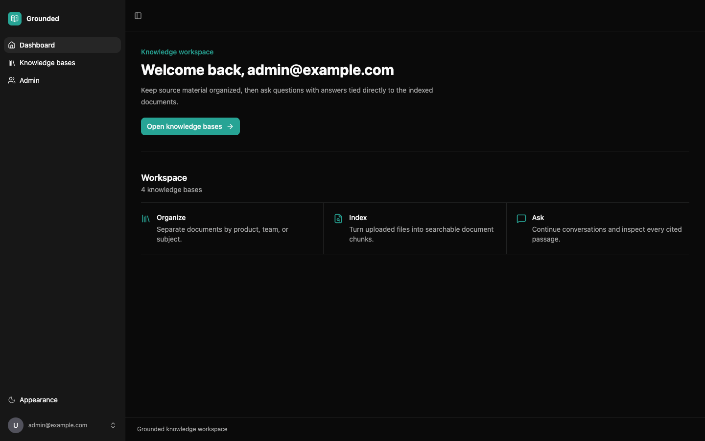
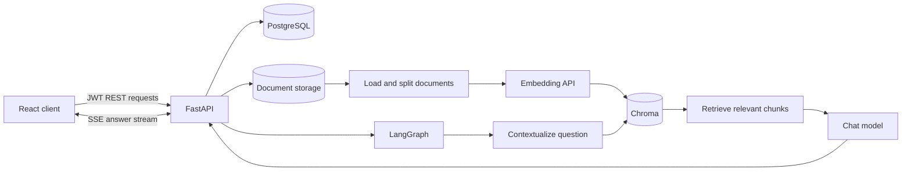

# Grounded - Enterprise RAG Assistant

Grounded is a full-stack retrieval-augmented generation (RAG) application for
building private, user-owned knowledge bases. Users can upload documents, ask
follow-up questions in persistent conversations, stream answers in real time,
and inspect the exact source passages used for each answer.



## Highlights

- JWT authentication and per-user data isolation
- Knowledge-base create, read, update, and delete workflows
- PDF, TXT, and Markdown upload with a 20 MB file limit
- SHA-256 duplicate-document detection
- Background parsing, chunking, embedding, and indexing
- Chroma similarity search with isolated collections per knowledge base
- LangGraph RAG workflow with conversational query rewriting
- Server-Sent Events (SSE) for token-by-token answers
- Persistent conversations, message history, and source citations
- Responsive React interface with generated, type-safe API clients
- Docker Compose development and deployment configuration

## Architecture



### Document ingestion

```text
Upload document
-> validate type and size
-> store the original file
-> detect duplicates with SHA-256
-> parse PDF/TXT/Markdown
-> split text into overlapping chunks
-> create embeddings
-> store vectors and metadata in Chroma
```

### Conversational RAG

```text
Question and recent chat history
-> rewrite follow-up as a standalone retrieval query
-> retrieve the most similar document chunks
-> build numbered context blocks
-> generate a grounded answer with [1], [2], ... citations
-> stream tokens to the browser with SSE
-> persist the question, answer, and sources in PostgreSQL
```

The generation prompt treats retrieved content as reference data rather than
instructions, helping reduce prompt-injection risk from uploaded documents.

## Technology Stack

| Layer | Technologies |
| --- | --- |
| Backend | Python 3.14, FastAPI, SQLModel, Pydantic, Alembic |
| RAG | LangChain, LangGraph, Chroma, DeepSeek, Zhipu AI Embeddings |
| Frontend | React 19, TypeScript, TanStack Router, TanStack Query |
| UI | Tailwind CSS, shadcn/ui, Lucide |
| Database | PostgreSQL 18 |
| Tooling | uv, Bun, Ruff, ty, Biome, Playwright |
| Runtime | Docker Compose, Traefik |

## Quick Start

### Prerequisites

- Docker Desktop with Docker Compose
- A DeepSeek API key
- A Zhipu AI API key

Host-side development commands such as client generation and static checks also
require [uv](https://docs.astral.sh/uv/) and [Bun](https://bun.sh/). Install the
workspace dependencies once with `uv sync --frozen` and
`bun ci --ignore-scripts` using Bun 1.4.2.

### 1. Configure the environment

```bash
cp .env.example .env
```

Edit `.env` and set at least:

```text
SECRET_KEY
FIRST_SUPERUSER_PASSWORD
POSTGRES_PASSWORD
DEEPSEEK_API_KEY
ZHIPUAI_API_KEY
```

Generate URL-safe secrets and passwords with:

```bash
openssl rand -hex 32
```

Use only URL-safe characters for `POSTGRES_PASSWORD`, because Compose embeds it
directly in a PostgreSQL connection URL.

Never commit `.env`; it is ignored by Git.

### 2. Build and initialize the application

```bash
docker compose build
docker compose run --rm backend bash scripts/prestart.sh
docker compose up -d
```

The initialization command applies all Alembic migrations and creates the
first superuser from `.env`.

### 3. Open the services

| Service | URL |
| --- | --- |
| Application through FastAPI | http://localhost:8000 |
| Application through Traefik | http://localhost |
| OpenAPI / Swagger | http://localhost:8000/docs |
| Adminer | http://localhost:8080 |
| Mailpit | http://localhost:8025 |
| Traefik dashboard | http://localhost:8090 |
| PostgreSQL | `localhost:5432` |
| Local SMTP | `localhost:1025` |

Log in with `FIRST_SUPERUSER` and `FIRST_SUPERUSER_PASSWORD` from `.env`.

The development override publishes these ports on the host. Run it only on a
trusted local machine or protect the ports with host firewall rules.

## Development

Use Compose Watch to synchronize backend changes and rebuild when frontend or
dependency files change:

```bash
docker compose watch
```

Stop the services without deleting PostgreSQL and uploaded-document volumes:

```bash
docker compose down
```

After changing a FastAPI route or schema, regenerate the TypeScript client:

```bash
bash scripts/generate-client.sh
```

This exports the OpenAPI schema, regenerates `frontend/src/client`, and runs
the configured frontend lint/format command. It can rewrite generated and
frontend source files, so review `git diff` afterward.

## Quality Checks

```bash
# Backend
cd backend
uv run ruff check app tests
uv run ruff format --check app tests
uv run ty check app

# Frontend, from the repository root
cd ..
bun run --filter frontend lint
bun run --filter frontend build
```

The frontend lint script uses Biome's write mode and may update files. Review
the resulting diff instead of treating it as a read-only check.

The full test script recreates its Compose stack and deletes that stack's
volumes. Stop the development stack first to avoid host-port conflicts, then
use a separate Compose project name so development volumes remain untouched:

```bash
docker compose down
COMPOSE_PROJECT_NAME=enterprise-rag-assistant-test bash scripts/test.sh
```

Do not run Pytest against a database containing data you need. Its fixtures
remove application records while preparing tests. If the script is interrupted
or a test fails before automatic cleanup, remove the isolated stack explicitly:

```bash
COMPOSE_PROJECT_NAME=enterprise-rag-assistant-test docker compose down -v --remove-orphans
```

## Project Structure

```text
backend/app/
  api/routes/             FastAPI knowledge-base and conversation endpoints
  alembic/                Database migrations
  services/
    document_storage.py   Safe local file persistence
    document_ingestion.py Parsing and chunking
    document_processor.py Background vector indexing
    rag_service.py        Model, embeddings, and Chroma factories
    rag_graph.py          LangGraph retrieval and generation workflow

frontend/src/
  client/                 Generated OpenAPI client and types
  components/KnowledgeBases/
                          Knowledge-base, document, and chat UI
  lib/streamConversation.ts
                          SSE client and event parser
  routes/                 File-based application routes
```

## Main API Areas

- `/api/v1/knowledge-bases/` - knowledge-base management
- `/api/v1/knowledge-bases/{id}/documents` - document lifecycle
- `/api/v1/knowledge-bases/{id}/search` - semantic retrieval
- `/api/v1/knowledge-bases/{id}/ask` - single-turn RAG answers
- `/api/v1/knowledge-bases/{id}/conversations` - conversation management
- `/api/v1/knowledge-bases/{id}/conversations/{conversation_id}/messages/stream`
  - persistent conversational RAG over SSE

All knowledge-base, document, conversation, and message operations verify
ownership against the authenticated user.

## Deployment

The repository includes `compose.deploy.yml` for HTTPS deployment through
Traefik and Let's Encrypt. A target server needs Docker Engine, public inbound
ports 80 and 443, and DNS records pointing `DOMAIN` to that server. The current
configuration also routes `adminer.DOMAIN`, so either create that DNS record or
remove the Adminer router before deployment.

Set a real `DOMAIN`, replace every placeholder secret, and initialize the
database before starting the deployment stack:

```bash
docker compose -f compose.yml -f compose.deploy.yml build
docker compose -f compose.yml -f compose.deploy.yml run --rm backend bash scripts/prestart.sh
docker compose -f compose.yml -f compose.deploy.yml up -d
```

Persisted PostgreSQL data, uploaded files, and Chroma indexes are stored in
Docker volumes so they survive container recreation.

Mailpit is development-only and is not included in the deployment stack.
Configure `SMTP_HOST`, `SMTP_USER`, `SMTP_PASSWORD`, and
`EMAILS_FROM_EMAIL` for a real SMTP service, or leave `SMTP_HOST` and
`EMAILS_FROM_EMAIL` empty to disable email features. The current deployment
uses the backend SMTP defaults: port 587 with STARTTLS.

`compose.deploy.yml` exposes Adminer publicly by default. Do not deploy it
unchanged on an internet-facing server: remove the Adminer routes or protect
them with an IP allowlist and additional authentication.

## Security Notes

See [dependency security](SECURITY.md) for audit commands and the reviewed Chroma advisory exceptions.

- Keep `.env` and API keys out of version control.
- Replace all sample passwords before any public deployment.
- Bind or firewall database, SMTP, dashboard, and administration ports.
- Use HTTPS in deployment and rotate any credential that may have been exposed.

## License

Distributed under the [MIT license](LICENSE). Original copyright notices and
license terms are retained in LICENSE.
